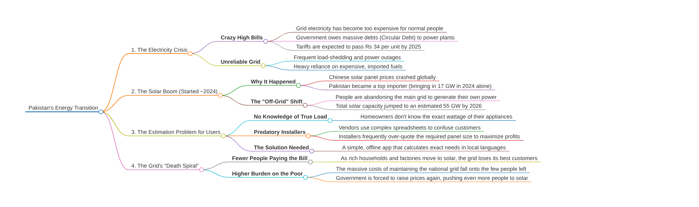
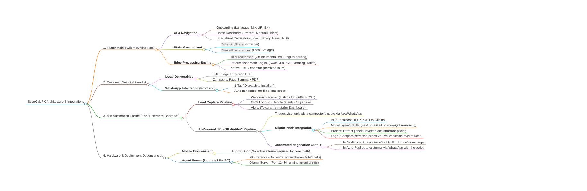
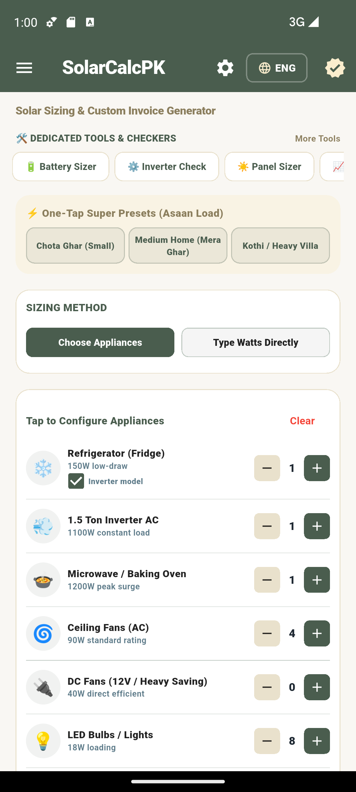

# RoshanGhar ☀️
### Smart, Offline-First Solar Engineering & ROI Auditor for Pakistan

[](https://flutter.dev)
[](https://dart.dev)
[](https://drive.google.com/drive/folders/1MZqfQNH0GD1WS7Zor_VbcXOIl7jqOF0_?usp=drive_link)
[](https://opensource.org/licenses/MIT)
[](test/)
[]()

**RoshanGhar** is a transparent, offline-first solar engineering and financial calculation application purpose-built for Pakistani homeowners, businesses, and electricians. It demystifies solar system sizing by eliminating predatory installer markups and providing rigorous, deterministic engineering math tailored to Pakistan's climate, grid tariffs, and solar irradiance.

---

## 🎬 Live Demo & Video Walkthrough

Watch the complete demonstration of RoshanGhar in action:
👉 **[Watch Live Demo & Video on Google Drive](https://drive.google.com/drive/folders/1MZqfQNH0GD1WS7Zor_VbcXOIl7jqOF0_?usp=drive_link)**

Key walkthrough highlights:
* **Full Onboarding Flow**: Multi-lingual selection (English, Urdu, and Roman Urdu Mix).
* **Live Load Profiling**: Dynamic appliance addition (Inverter ACs, DC fans, water pumps, refrigerators).
* **Smart Battery Sizing**: Chemistry-specific DoD (LiFePO4, Tubular, AGM) and wiring topologies.
* **City PSH Solar Sizing**: Real regional sun-hours calculation with system derating.
* **Inverter Headroom Checker & ROI Payback**: Financial savings and surge trip prevention.
* **One-Tap Installer Handoff**: Auto-generated WhatsApp dispatch format and on-device PDF invoice / Bill of Materials (BOM).

---

## 📌 Socio-Economic Context & Problem Statement

Pakistan is currently experiencing an unprecedented energy transformation driven by two colliding forces: **skyrocketing electricity bills** and a **historic solar boom**.

### 1. The Energy Crisis & Predatory Sizing
As DISCO tariffs exceed **Rs 35–65+ per unit** (inclusive of fuel adjustments, surcharges, and taxes), grid electricity has become unaffordable for ordinary households. Homeowners are turning to solar in record numbers (with Pakistan importing over **17 GW of solar panels in 2024 alone** and approaching ~55 GW capacity by 2026).

However, consumers face a severe information asymmetry:
* **Predatory Installers**: Unscrupulous vendors exploit homeowners' lack of technical knowledge, using opaque spreadsheets to intentionally over-quote panel quantities and inverter sizes to maximize sales commissions.
* **Mismatched Components**: Inverters frequently trip because continuous load and motor surge headrooms are calculated incorrectly.
* **Battery Inefficiencies**: Batteries are often undersized or wired in sub-optimal string topologies, destroying battery cycle life.

### 2. Socio-Economic Mindmaps

#### The Problem: Pakistan's Energy Transition Dilemma


#### The Solution: RoshanGhar Architecture & Value Chain


---

## 📱 App Screenshot

<div align="center">
  
</div>

---

## 🚀 What RoshanGhar Does

RoshanGhar puts the power of an experienced solar engineer into the pocket of everyday citizens. It operates completely **offline** without requiring constant internet access or cloud dependencies.

### 1. 🧮 Dedicated Engineering Calculators & Checkers
* **⚡ Itemized Load Calculator**:
  * Comprehensive preset database of common Pakistani domestic & commercial appliances (1.0 Ton & 1.5 Ton Inverter ACs, DC solar fans, standard induction fans, inverter refrigerators, water pumps, microwaves, LED fixtures).
  * Real-time continuous wattage aggregation and peak kW calculation.
  * Custom load additions with adjustable quantities and operating wattage.
* **🔋 Battery Bank Sizer**:
  * Chemistry-specific Depth of Discharge (DoD) profiling: **LiFePO4 (90% DoD)**, **Tubular (60% DoD)**, and **AGM (50% DoD)**.
  * System DC voltage string calculation (12V, 24V, 48V) with recommended series/parallel wiring diagrams.
  * Autonomy hours calculation to ensure essential loads remain operational during night-time load shedding.
* **☀️ Solar Panel Array Sizer**:
  * Real regional **Peak Sun Hours (PSH)** mapping across major Pakistani cities (Karachi 5.5, Lahore 4.8, Islamabad 4.5, Peshawar 5.0, Quetta 6.0, Multan 5.8, Faisalabad 4.9, Attock 4.7, Swabi 4.8).
  * Derating factor adjustments (standard 20% system loss for dust, temperature coefficient, and cable drops).
  * Computes required panel counts for modern Tier-1 panel wattages (545W, 585W, 600W).
* **🔌 Inverter Capacity & Headroom Checker**:
  * Validates continuous running watts against rated inverter kW.
  * Enforces safe surge headroom (1.25x – 1.30x) to handle inductive motor startup spikes without tripping.
* **💰 ROI & Payback Calculator**:
  * Calculates realistic financial payback in years and estimated 25-year lifetime savings.
  * Factors in domestic grid unit costs, unit consumption inflation, and self-consumption ratios.

---

### 2. 🇵🇰 Pakistani Localization & Natural Language Engine
* **Trilingual Interface**: Full support for **English**, **Urdu (اردو)**, and **Roman Urdu Mix** ("Hinglish" / everyday colloquial Pakistani language).
* **Edge NLP Parsing (`NlpLoadParser`)**:
  * Allows users to type or dictate natural language sentences in Roman Urdu, Pashto, or English.
  * Understands regional terms like *tanor* (oven), *grop* (bulb), *solar panka* (DC fan), as well as number words (*yaw, dwa, dre, shpa*, *ek, do, teen, chaar*).

---

### 3. 📈 Live Wholesale Market Rates
* Integrated ticker and price index for Tier-1 solar panels in Pakistan (**Longi, Jinko, Canadian Solar, JA Solar**).
* Displays live wholesale market rates in PKR per watt (`PKR/Watt`), preventing customers from paying inflated retail markups.

---

### 4. 📤 Seamless Deliverables & Handoff
* **1-Tap WhatsApp Technician Dispatch**:
  * Generates an itemized technical load profile formatted cleanly for WhatsApp.
  * Dispatches pure technical specifications directly to installers without exposing consumer price calculations or margins.
* **Professional PDF Quotation & Bill of Materials (BOM)**:
  * Generates on-device, printable PDF proposals complete with system summary, equipment breakdown, and estimated solar output.
  * Supports compact 1-page summary quotes as well as multi-page documentation.

---

## 🛠️ Technology Stack & Architecture

* **Frontend Framework**: [Flutter](https://flutter.dev) (Dart 3.x) with Material 3 responsive design.
* **State Management**: `ChangeNotifierProvider` (`SolarAppState`) with persistent local storage via `SharedPreferences`.
* **Mathematical Core**: Deterministic math engine (`SolarCalculations`) built to international IEC/IEEE standards adapted for Pakistan.
* **PDF Engine**: Native vector PDF rendering via `pdf` & `printing` packages.
* **Deep Linking**: `url_launcher` for zero-overhead direct WhatsApp integration.

```
lib/
├── app_state.dart              # Global reactive state & localization logic
├── main.dart                   # Application entrypoint & Material 3 theming
├── models/
│   └── appliance.dart          # Appliance data models & serialization
├── screens/
│   ├── home_screen.dart        # Main dashboard & quick all-in-one sizer
│   ├── load_calculator_screen.dart # Detailed itemized load profiler
│   ├── battery_sizer_screen.dart   # Battery bank & wiring configurator
│   ├── panel_sizer_screen.dart     # City PSH solar panel sizing tool
│   ├── inverter_checker_screen.dart# Inverter capacity & surge analysis
│   ├── roi_calculator_screen.dart  # Financial payback & lifetime ROI
│   └── onboarding_screen.dart      # First-launch language & profile setup
├── services/
│   ├── nlp_load_parser.dart    # Offline multi-lingual rule-based NLP engine
│   ├── pdf_invoice_service.dart# Vector PDF proposal & BOM generator
│   ├── solar_price_service.dart# Live Tier-1 Pakistani panel price index
│   ├── whatsapp_service.dart   # Technical dispatch via WhatsApp URI
│   └── n8n_audit_service.dart  # AI engineering audit webhook connector
├── utils/
│   └── calculations.dart       # Deterministic solar calculation formulas
└── widgets/
    ├── app_drawer.dart         # Drawer navigation destination menu
    ├── admob_banner.dart       # Responsive ad container placeholder
    └── result_card.dart        # Reusable responsive metrics card
```

---

## 🧪 Testing & Verification

RoshanGhar includes a robust test suite covering mathematical formulas, edge-case NLP handling, and narrow-screen responsiveness across mobile devices:

```bash
# Run all automated tests
flutter test

# Run static code analysis
dart analyze
```

* **Unit Tests**: Verifies battery DoD math, city-specific PSH panel counts, inverter surge buffers, and 25-year ROI payback calculations.
* **NLP Tests**: Validates Pashto, Roman Urdu, and English sentence extractions.
* **Widget & Overflow Tests**: Validates that all screens render without overflow even on ultra-compact 320px width mobile screens.

---

## 🏁 Getting Started

### Prerequisites
* [Flutter SDK](https://docs.flutter.dev/get-started/install) (`^3.12.0` or higher)
* Android Studio / VS Code with Flutter extension

### Installation

1. **Clone the repository**:
   ```bash
   git clone https://github.com/qasim185/RoshanGhar.git
   cd RoshanGhar
   ```

2. **Install dependencies**:
   ```bash
   flutter pub get
   ```

3. **Run on connected device or emulator**:
   ```bash
   flutter run
   ```

4. **Build release APK (Android)**:
   ```bash
   flutter build apk --release
   ```

---

## 📜 License

Distributed under the MIT License. See `LICENSE` for more information.

---

## 🤝 Contributing

Contributions, feedback, and regional tariff updates are welcome!
Feel free to open an Issue or submit a Pull Request.
